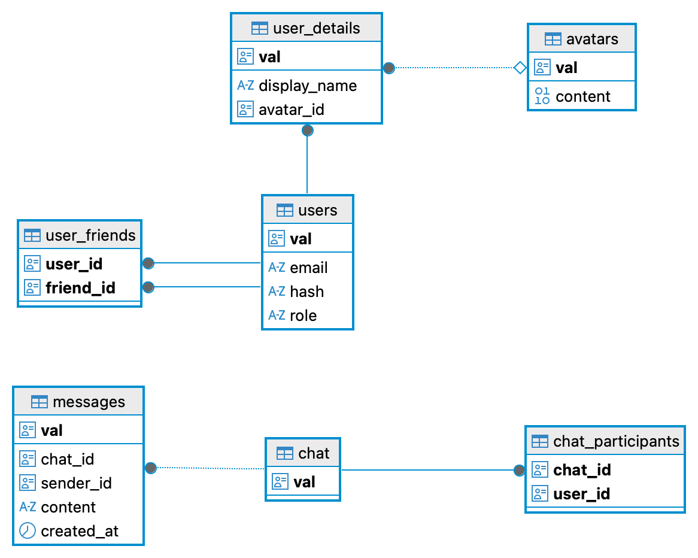

*This project has been created as part of the 42 curriculum by [kikwasni](https://github.com/kingak4), [alraltse](https://github.com/alrltgit), [korzecho](https://github.com/Fistxszek), [sandrzej](https://github.com/monandszy), [zslowian](https://github.com/aktyz)*

  

## 🔒 License
This project is licensed under the GNU GPL v3 License.

➡️ [[GNU GPL v3 License](LICENSE.md)]

LICENSE.md)]

## 📌 JustPlay42 Project Description

JustPlay42 is a team-based web application developed at **42 Warsaw** as part of the `ft_transcendence` project. The platform combines real-time communication with the classic 2048 puzzle game, allowing users to connect, chat, and compete with friends.

The platform provides the following functionalities:

- **Authentication:** A user management system supporting registration, login, and session handling.

- **Interactive Chat:** A real-time messaging system that allows users to communicate, connect with friends, and interact directly through the platform.

- **2048 Game:** A classic puzzle game where players combine tiles with the same number to create larger values, aiming to reach the 2048 tile.

- **Challenges and Competition:** Users can challenge their friends through the chat, adding a competitive element to the gaming experience.

- **User Profiles:** Individual profiles that allow users to have their own identity within the platform.

The goal of JustPlay42 is to bring gaming and social interaction together in one place, creating an engaging environment where users can communicate, challenge their friends, and enjoy playing together 

## ⚙️ Setup

Create and configure the environment files before running the project:

- [infra/.env](infra/.env) and [infra/.env.example](infra/.env.example)
- [infra/postgres/.env](infra/postgres/.env) and [infra/postgres/.env.example](infra/postgres/.env.example)
- [infra/redis/.env](infra/redis/.env) and [infra/redis/.env.example](infra/redis/.env.example)
- [backend/.env](backend/.env) and [backend/.env.example](backend/.env.example)
- [backend/transcend/.env](backend/transcend/.env) and [backend/transcend/.env.example](backend/transcend/.env.example)
- [frontend/.env](frontend/.env) and [frontend/.env.example](frontend/.env.example)

## ▶️ Instructions

From the repository root, start the application on dev profile with `make up`. 

Components can be started separately (on dev or local profiles) using makefiles in infra, backend, or frontend folders (see supporting documentation).

Supporting documentation:

- [Infrastructure README](infra/README.md)
- [Backend README](backend/README.md)
- [Frontend README](frontend/README.md)

Application will be available via nginx proxy on port 8443.

## 👥 Team Information
### [Kinga](https://github.com/kingak4) — Project Manager & Developer

Lead the project through the full development lifecycle while contributing as a developer.

* **Project Management & Team Coordination:** Coordinated team communication, facilitated discussions and negotiations, and helped resolve conflicts to maintain effective collaboration. Organized meetings, aligned team members on decisions and next steps, tracked task progress, and supported task distribution and ongoing project planning.
* **Documentation:** Created Confluence articles, architecture diagrams, feature specifications, and visual guides for the project knowledge base. Coordinated documentation and knowledge sharing across the entire team.
* **UI/UX Design:** Designed the application's visual identity and user interface, creating high-fidelity mockups and feature visualizations in Canva. Planned the layout, user flows, and overall user experience to ensure a consistent design across all modules.
* **Design Documentation:** Documented UI concepts, workflows, and feature specifications in Confluence, providing implementation guidelines and maintaining design consistency throughout development.
* **Project Documentation Repository:** Created and maintained the [Documentation](docs/) folder containing project-related documentation, including UI/UX visualizations, articles, meeting presentations, and progress tracking materials. Organized resources such as design concepts, feature descriptions, project updates, and presentation materials to provide a centralized knowledge base for the team.

  Documentation resources include:
  * [UI/UX Design Concepts & Visualizations](docs/42Hub%20UIUX%20design%20upgrade)
  * [Articles & Technical Notes](docs/Articles)
  * [Meeting Presentations](docs/Meetings-archive)
  * [UI/UX Archive](docs/UIUX-archive)
  * [Forum Archive](docs/Forum-archive)
  * [Progress Tracker](docs/README-progress-tracker)

* **Chat Module:** Implemented the Real-Time Chat Module feature.
* **UI/UX Implementation Support:** Created high-fidelity mockups for the entire application and participated in the process of translating the designed interfaces into the frontend implementation. Collaborated with the frontend team to ensure consistency between the proposed design, user flows, and the final application interface. Related documentation: [Frontend Design Integration](docs/Frontend-Design-Integration).
* **Code Quality:** Managed pull requests and conducted code reviews with the Technical Lead.
* **Legal & Compliance:** Created and integrated the Privacy Policy and Terms of Service pages, drafted the required legal documentation, and integrated the Open-Source License into the repository.

### [Szymon](https://github.com/monandszy) — Technical Lead, Software Architect
Managed the technical side of the project during initial stages of development. Defined the technology stack and standards.

#### Individual Contributions
- Architectured a Hexagonal spring boot backend following SOA, DDD, UseCase centric design, separation of Concerns and CQRS, enabling development consistent with the Open closed principle.
- Oversaw frontend backend JWT token integration, for stateless Rest API and STOMP websocket AsyncApi, allowing for secure token isolation and permission management with Spring Security.
- Documented the backend according to the Docs as Code, Self Documenting Code, and Living Documentation principles.
- Utilized gradle plugins and test pipelines for diagram and asciidoc generation, providing insight into the architecture and state of the backend.
- Tested the backend in accordance with TDD and BDD, utilized Spring context splitting.
- Integrated Spring WebSockets with Redis.

### [Alina](https://github.com/alrltgit) — DevOps, Database Engineer
Designed and maintained the project's infrastructure and database layer

#### DevOps

*   **Containerization:** Containerized the backend and frontend applications using Docker.
*   **Infrastructure:** Configured PostgreSQL and the Docker Compose environment for local development.
*   **Environment Management:** Established a shared, idempotent Docker network and coordinated environment configuration across Docker Compose and Makefiles.
*   **Build & Compatibility:** Improved the Docker build process.

#### Database Engineer

*   **Database Design:** Designed and updated the database schema as new features were added.
*   **Persistence:** Integrated PostgreSQL with the backend using Spring Data JPA and implemented the repositories.
*   **Transactions:** Researched and applied transaction management to keep data consistent.
*   **Migrations:** Set up database migrations and managed schema changes over time.
*   **Testing:** Wrote integration tests for the repository layer.
*   **Documentation:** Created and maintained database documentation, including the entity-relationship diagram.

### [Kacper](https://github.com/Fistxszek) — Frontend Developer, API Integration Engineer
Led the initial frontend setup and established core integrations for REST API and WebSocket communication.

*   **Frontend Architecture:** Bootstrapped the Next.js application and development environment, including linters, formatters, and initial HTTPS configuration.
*   **2048 Game Development:** Designed and implemented the 2048 game, integrating its core gameplay mechanics into the platform to enable users to play and compete with friends.
*   **API Integration:** Developed the integration layer between the Next.js frontend and the Spring Boot backend. Implemented the BFF (Backend-for-Frontend) pattern, API web clients, and robust error handling for authentication flows (login/register).
*   **Real-Time Communication:** Integrated WebSocket (STOMP) connections on the client side, enabling real-time chat functionality and live user presence (online/offline) updates.
*   **UI/UX Design:** Designed and developed the foundational layout and aesthetics for the platform's landing page and user profile views.
*   **Chat implementation:** Developed the chat logic based on STOMP and HTTPS backend endpoints, with sending and removing messeges, creating conversations with friends and error handling when backend connection breaks.

### [Zyta](https://github.com/aktyz) — Product Owner, Frontend Developer & Designer
Owned the application's visual language and frontend quality bar, and the build environments the team develops and evaluates on.

*   **Product Owner:** Set the direction for the workstreams she led — design system, theming, social features, accessibility, and internationalization.
*   **Design System & Theming:** Responsible for the design-token layer, the shared component library, and the three application themes.
*   **Identity & Social Frontend:** Responsible for the profile, friends, and chat surfaces of the SPA.
*   **Accessibility & Internationalization:** Responsible for WCAG 2.1 AA compliance and multi-language support (EN / PL / FR / AR with RTL).
*   **CI & Build Environments:** Responsible for the GitHub Actions pipeline, the two supported build profiles, and their automated verification.

### 📊 Project Management

Established a structured workflow for team coordination and task execution:

* **Kick-off Meeting:** Defined the application concept, project scope, and allocated team roles through collaborative brainstorming.
* **Task Distribution:** Assigned development tasks based on team members' responsibilities and agreed priorities.
* **Synchronization:** Organized regular full-team and sub-team meetings to monitor progress and resolve blockers.
* **Hybrid Meetings:** Coordinated both on-site sessions at the 42 Warsaw campus and remote meetings.
* **Timeline Management:** Monitored project progress, adapted priorities to meet deadlines, and coordinated scope adjustments when necessary.
* **Design Coordination:** Planned the application's interface and feature designs before implementation, ensuring developers followed a unified vision documented in Confluence.
* **Team Support & Collaboration:** Supported and motivated team members throughout the development process, fostering a positive and collaborative atmosphere. Encouraged open communication, knowledge sharing, and teamwork to maintain strong team engagement and effective cooperation.

**Tools:** Jira (task tracking), Confluence (project documentation, architecture & design specifications), Canva (UI/UX mockups and feature visualizations), Slack (project communication), Messenger (rapid team updates).

## 🛠️ Technical Stack

### Frontend Technologies and Frameworks
* **Next.js**: The core frontend framework, chosen due to its industry-standard status, and its powerful Server-Side Rendering (SSR) capabilities which improve performance and SEO.
* **TailwindCSS & Catppuccin**: Used for styling and theming, allowing for a robust, reusable, and easily switchable custom design system.
* **openapi-fetch**: For type-safe API calls generated directly from backend OpenAPI specifications.
* **sockJS & @stomp/stompjs**: For handling STOMP WebSocket connections to provide real-time updates and messaging.

### Backend Technologies and Frameworks
* **Spring Boot**: Used as the core backend framework, mainly because Szymon (Technical Lead, Software Architect) already had experience with it, which made development faster and lowered the risk of getting stuck on the learning curve.
* **Spring Data JPA (Hibernate)**: Handles the mapping between our Java objects and the PostgreSQL database, so we don't have to write repetitive SQL by hand.
* **Liquibase**: Keeps track of database schema changes over time, so updates stay consistent and easy to reproduce across environments.

### Database Technologies
* **PostgreSQL**: Our main database. We went with it because it's one of the most popular and reliable open-source options out there, and it works smoothly with Spring Boot.
* **Redis**: Used alongside PostgreSQL. Like Postgres, it's open-source, well-supported, and integrates easily with the rest of our Spring Boot setup.

### Other Significant Technologies and Libraries
* **Nginx**: A lightweight and powerful open-source router configured for SSL certificate termination and request proxying.
* **Makefile & Docker**: Custom orchestration setup made to adhere to the separation of concerns and ensure simple, reproducible builds.

## 🔄 Development Lifecycle & Practices

### Workflow
All feature development followed a structured, API-first approach that enabled parallel execution across different technology layers:
* **Requirements & Core Domain:** Feature development began with business requirements defined by the Project Manager (**Kinga**). The Technical Lead (**Szymon**) then implemented the core domain models and use cases in Java, exposing the functionality via REST and Async APIs.
* **Parallel Integration:** Once the API contracts were established, the team split into simultaneous tracks to prevent bottlenecks:
  * **Persistence Layer (Infra):** Implementing database repositories and integrating infrastructure (**Alina**).
  * **Client Layer (Frontend):** Designing the UI components (**Zyta**) and consuming the backend endpoints (**Kacper**).

### CI/CD Pipeline
Integration standards were enforced through an CI pipeline combined with team policies and repository configuration:

* **Continuous Integration (GitHub Actions):** Every push and pull request targeting `main` runs a three-job pipeline:
  * **Backend tests** — the Gradle test suite executed inside Docker against PostgreSQL and Redis containers.
  * **Dev/eval build verification** — brings up the containerized stack and asserts the security topology: REST and STOMP endpoints must answer through nginx's HTTPS proxy while the backend's ports are confirmed closed. It then generates API types from the live OpenAPI/AsyncAPI specs, lints and builds the Next.js frontend, and verifies the homepage is served end-to-end through nginx.
  * **Local build verification** — validates the frontend developer workflow: the backend must be published on loopback only (`127.0.0.1:5001`, invisible to the network) with health and STOMP endpoints reachable for a host-run dev server.
  * Docker layer, Gradle, and Next.js caches keep pipeline runs to a few minutes.

### Team's Code Quality & Version Control Standards
* **Formatters & Linters:** Integrated static analysis tools to eliminate stylistic debates, catch logical bugs before runtime, and enforce framework best practices. This allowed peer reviews to focus entirely on architecture and business logic.
* **GitHub Flow:** Adopted a feature-branching strategy. Developers frequently synced with the main branch to preempt massive merge conflicts, submitting all work exclusively through Pull Requests.
* **Conventional Commits:** Enforced structured commit messaging. This provided instant context for changes, streamlined debugging, and prepped the repository for automated release changelogs.
* **Repository Protection & Linear History:** Configured GitHub branch protection rules to disable pushes to main and require peer approvals. All PRs were integrated using "Squash and Merge," ensuring the main branch maintained a clean, readable, and chronological history of deployable features.

## 🗄️ Database Schema

### Column Data Types

#### `user_details`
| Column | Type |
|---|---|
| `val` | `UUID` |
| `display_name` | `varchar(255)` |
| `avatar_id` | `UUID` |

#### `avatars`
| Column | Type |
|---|---|
| `val` | `UUID` |
| `content` | `bytea` |

#### `user_friends`
| Column | Type |
|---|---|
| `user_id` | `UUID` |
| `friend_id` | `UUID` |

#### `users`
| Column | Type |
|---|---|
| `val` | `UUID` |
| `email` | `varchar(255)` |
| `hash` | `varchar(255)` |
| `role` | `public."user_role"` |

**Note:** `role` uses a custom Postgres **enum** type.

#### `chat`
| Column | Type |
|---|---|
| `val` | `UUID` |

#### `chat_participants`
| Column | Type |
|---|---|
| `chat_id` | `UUID` |
| `user_id` | `UUID` |

#### `messages`
| Column | Type |
|---|---|
| `val` | `UUID` |
| `chat_id` | `UUID` |
| `sender_id` | `UUID` |
| `content` | `text` |
| `created_at` | `timestamptz` |

## ✨ Features List
* **GetChatMessages** — *[Kinga](https://github.com/kingak4)* & *[Szymon](https://github.com/monandszy)* — Loads a chat's message history, page by page.
* **GetChats** — *[Kinga](https://github.com/kingak4)* & *[Szymon](https://github.com/monandszy)* — Returns the list of chats a user is part of.
* **ManageMessages** — *[Kinga](https://github.com/kingak4)* & *[Szymon](https://github.com/monandszy)* — Lets users send and delete messages, with checks in place so messages can't be empty and users can only delete their own.
* **StartChat** — *[Kinga](https://github.com/kingak4)* & *[Szymon](https://github.com/monandszy)* — Starts a new chat between two users, or just returns the existing one if they already have a chat going.
* **GetProfile** — *[Szymon](https://github.com/monandszy)* — Fetches a user's profile details, and their avatar (falling back to a default avatar if one isn't set).
* **ManageFriends** — *[Szymon](https://github.com/monandszy)* — Lets users add, remove, and view their friends list.
* **ReadPresence** — *[Szymon](https://github.com/monandszy)* — Checks whether a given user is currently online.
* **Register** — *[Szymon](https://github.com/monandszy)* — Handles new user sign-up, making sure the email isn't already taken and setting up default profile details.
* **UpdateAvatar** — *[Szymon](https://github.com/monandszy)* — Lets a user upload and set a new avatar.
* **UpdatePresence** — *[Szymon](https://github.com/monandszy)* — Marks a user as online or offline based on their session.
* **Login** — *[Szymon](https://github.com/monandszy)* — Verifies a user's email and password, and issues an access token if they match.
* **SearchUsers** — *[Szymon](https://github.com/monandszy)* — Searches for users by name, with paging and a max page size to keep results manageable.
* **UpdateDisplayName** — *[Szymon](https://github.com/monandszy)* — Lets a user change their display name.

## Modules

**Total Points Calculated: 19 Points** (Major = 2pts, Minor = 1pt)

### 42Hub Modules table summary

| Module ID | Module Name | Points | Detailed requirements list | 42Hub requirements fulfillment |
| --- | --- | --- | --- | --- |
| [1](#module-1) | [IV.1 Web - A. Use a framework for both the frontend and backend.](#module-1) | 2 |◦ Use a frontend framework (React, Vue, Angular, Svelte, etc.).◦ Use a backend framework (Express, NestJS, Django, Flask, Ruby on Rails, etc.).◦ Full-stack frameworks (Next.js, Nuxt.js, SvelteKit) count as both if you use both their frontend and backend capabilities.| Java Spring Boot on Backend, Next.js on Frontend |
| [2](#module-2) | [IV.1 Web - D. Implement real-time features using WebSockets or similar technology.](#module-2) | 2 |◦ Real-time updates across clients.◦ Handle connection/disconnection gracefully.◦ Efficient message broadcasting. | |
| [3](#module-3) | [IV.1 Web - E. Allow users to interact with other users.](#module-3) | 2 | ◦ A basic chat system (send/receive messages between users).◦ A profile system (view user information).◦ A friends system (add/remove friends, see friends list).| |
| [4](#module-4) | [IV.1 Web - F. A public API to interact with the database with a secured API key, rate limiting, documentation, and at least 5 endpoints](#module-4) | 2 | | |
| [5](#module-5) | [IV.1 Web - G. Use an ORM for the database.](#module-5) | 1 | | |
| [6](#module-6) | [IV.1 Web - J. Server-Side Rendering (SSR) for improved performance and SEO.](#module-6) | 1 | | |
| [7](#module-7) | [IV.1 Web - L. Custom-made design system with reusable components, including a proper color palette, typography, and icons (minimum: 10 reusable components).](#module-7) | 1 | | |
| [8](#module-8) | [IV.2 Accessibility and Internationalization - A. Complete accessibility compliance (WCAG 2.1 AA) with screen reader support, keyboard navigation, and assistive technologies.](#module-8) | 2 | | |
| [9](#module-9) | [IV.2 Accessibility and Internationalization - B. Support for multiple languages (at least 3 languages).](#module-9) | 1 | | |
| [10](#module-10) | [IV.2 Accessibility and Internationalization - C. Right-to-left (RTL) language support.](#module-10) | 1 | | |
| [11](#module-11) | [IV.2 Accessibility and Internationalization - D.  Support for additional browsers.](#module-11) | 1 | | |
| [12](#module-12) | [IV.3 User Management - A. Standard user management and authentication.](#module-12) | 2 | ◦ Users can update their profile information.◦ Users can upload an avatar (with a default avatar if none provided).◦ Users can add other users as friends and see their online status.◦ Users have a profile page displaying their information.| |
| [13](#module-13) | [IV.10 Modules of Choice: CI on GitHub](#module-13) | 1 | | |

### IV.1 Web

#### 1. Framework-Based Architecture (Major — 2pts)
* **Implementation:** Backend built with **Java Spring Boot**; frontend built with **Next.js** using a Backend-for-Frontend (BFF) pattern.
* **Justification:** Provides a robust ecosystem, dependency injection on the backend, and industry-standard SSR capabilities on the frontend.
* **Contributors:** All team members

[↑ Back to modules table](#modules-table)

#### 2. Real-Time WebSockets Module (Major — 2pts)
* **Implementation:** Built a real-time system using **Java WebSockets (STOMP protocol)** and **sockJS** on the frontend. Broadcasts messages, synchronizes status, and handles disconnects.
* **Justification:** Eliminates HTTP polling overhead, providing an immersive, low-latency user experience for chatting and presence updates.
* **Contributors:** Szymon, Kacper

[↑ Back to modules table](#modules-table)

#### 3. User Interaction & Core Social Systems (Major — 2pts)
* **Implementation:** Developed a chat system (send/receive messages), user profile pages, and a friends system (add/remove friends, online statuses).
* **Justification:** Establishes the core pillars for a social platform, allowing users to connect and communicate effectively.
* **Contributors:** All team members

[↑ Back to modules table](#modules-table)

#### 4. Secured Public API (Major — 2pts)
* **Implementation:** Developed a public REST API for database interaction, protected via JWT Tokens, with rate limiting and comprehensive documentation (OpenAPI). Includes 5 distinct endpoints.
* **Justification:** Essential for allowing secure client interactions while protecting the backend from unauthorized access or brute-force requests.
* **Contributors:** Szymon

[↑ Back to modules table](#modules-table)

#### 5. Database Object-Relational Mapping (Minor — 1pt)
* **Implementation:** Used **Spring Data JPA (Hibernate)** as the ORM layer for object-to-database mapping in PostgreSQL.
* **Justification:** Prevents SQL injection vulnerabilities, maintains type safety, and abstracts database schema complexity.
* **Contributors:** Alina

[↑ Back to modules table](#modules-table)

#### 6. Server-Side Rendering (SSR) (Minor — 1pt)
* **Implementation:** Leveraged Next.js Server Components and server-side logic for rendering profiles and layouts before sending them to the client.
* **Justification:** Ensures faster First Contentful Paint, improved performance, and significantly better SEO compared to a standard SPA.
* **Contributors:** Zyta, Kacper

[↑ Back to modules table](#modules-table)

#### 7. Custom-made Design System (Minor — 1pt)
* **Implementation:** Built a semantic design-token layer using TailwindCSS and Catppuccin, extracting more than 10 reusable components (Buttons, Cards, TextFields, Avatars, etc.).
* **Justification:** Ensures visual consistency, allows rapid theming across the application, and standardizes UI 
* **Contributors:** Zyta, Kinga

[↑ Back to modules table](#modules-table)

---

### IV.2 Accessibility and Internationalization

#### 8. WCAG 2.1 AA Accessibility Compliance (Major — 2pts)
* **Implementation:** Brought every page to WCAG 2.1 AA in all three themes. Contrast was fixed at the design-token level; pages gained a skip link, per-page titles, landmark regions, and keyboard-reachable scroll regions; a reusable `Dialog` built on the native `<dialog>` element handles focus management; a live-region announcer lets screen readers speak incoming chat messages; and form fields carry programmatic labels, required state, and `autoComplete` hints. The 2048 game is playable by keyboard and screen reader. `eslint-plugin-jsx-a11y` in strict mode blocks regressions, and compliance was verified with axe-core scans (driven by Playwright) of every route in every theme and language, plus a manual NVDA screen-reader pass.
* **Justification:** Real-time chat and games are where assistive-technology users are most often left out, and a social platform that only part of its audience can use fails its purpose. Because colors already flowed through semantic design tokens, meeting contrast requirements took one change per token instead of one per component.
* **Contributors:** Zyta, Kacper

[↑ Back to modules table](#modules-table)

#### 9. Support for Multiple Languages (Minor — 1pt)
* **Implementation:** The full interface is available in English, Polish, French, and Arabic, built with **next-intl** and one message catalogue per language (`messages/*.json`). Users switch language from the footer; a server action stores the choice in an HttpOnly `NEXT_LOCALE` cookie, so server-rendered pages arrive already translated. Type-checking enforces that all four catalogues define the same keys, and the `react/jsx-no-literals` lint rule stops untranslated text from entering the UI. Backend error responses are mapped to translated messages instead of being shown in English, and server-only text (the legal pages) is kept out of the client bundle.
* **Justification:** Polish serves the team's home campus, English is the common language of the 42 network, French reflects 42's origin, and Arabic exercises right-to-left support. next-intl was chosen because it works with Next.js Server Components, so translation happens on the server alongside SSR.
* **Contributors:** Zyta, Kacper

[↑ Back to modules table](#modules-table)

#### 10. Right-to-Left (RTL) Language Support (Minor — 1pt)
* **Implementation:** Selecting Arabic switches the document to `<html dir="rtl" lang="ar">` from a single source of truth (`getDirection()` in `lib/i18n/config.ts`), so the layout, sidebar, chat bubbles, and footer links mirror. User-generated content is wrapped in `<bdi>` so names and messages that mix scripts render in the correct order, and a dedicated Arabic font applies through the `:lang(ar)` selector. The language and theme toggles stay left-to-right so they do not move under the pointer when switching languages.
* **Justification:** RTL support is more than translated text: reading order, alignment, and mixed-direction user input must all follow the language. Setting direction in markup rather than CSS also informs assistive technology and the browser's bidirectional text algorithm.
* **Contributors:** Zyta, Kacper

[↑ Back to modules table](#modules-table)

#### 11. Support for Additional Browsers (Minor — 1pt)
* **Implementation:** Verified and adjusted UI/UX consistency and feature compatibility across major modern browsers.
* **Justification:** Broadens accessibility to users regardless of their browser preference.
* **Contributors:** Alina

[↑ Back to modules table](#modules-table)

---

### IV.3 User Management

#### 12. Standard User Management & Authentication (Major — 2pts)
* **Implementation:** Used **Spring Security** for registration/login flows. Users can update their profile information and upload custom avatars.
* **Justification:** Securing user identity and managing profiles is the foundational requirement for personalizing the user experience and maintaining data integrity.
* **Contributors:** Szymon, Kacper, Alina

[↑ Back to modules table](#modules-table)

---

### IV.10 Modules of Choice

#### 13. Modules of Choice: CI on GitHub (Minor — 1pt)
* **Implementation:** Created a comprehensive GitHub Actions CI pipeline separating frontend and backend jobs. It handles API type generation, Docker stack bring-up, Gradle caching, and end-to-end verification.
* **Justification:** We chose GitHub Actions CI because automated verification is critical for a dual-stack architecture. It addresses the technical challenge of ensuring the API contracts (OpenAPI/AsyncAPI) stay synced with the frontend before merging, preventing regression bugs and broken builds. It deserves module recognition because it significantly stabilized our development workflow.
* **Contributors:** Zyta

[↑ Back to modules table](#modules-table)

---

## 🙋 Individual Contributions

### Kinga

As Project Manager and Developer, Kinga guided the project through its full development lifecycle — structuring task distribution, organizing hybrid team meetings, and coordinating work across sub-teams — while also contributing hands-on to the codebase. She shaped the application's visual identity from the ground up, designing high-fidelity mockups and feature visualizations in Canva that served as the team's shared reference point for UI/UX work. Beyond the design work itself, she was directly involved in bringing that vision into the product, collaborating with the frontend team on translating the mockups into the interface and helping integrate them with the existing codebase. She authored the project's Confluence documentation, architecture diagrams, and feature specifications, and maintained the repository's [Documentation](docs/) folder as the team's centralized knowledge base. She also implemented the Real-Time Chat Module, managed pull requests and code reviews with the Technical Lead, and drafted and integrated the Privacy Policy, Terms of Service, and Open-Source License.

### Zyta

As Frontend Developer, Designer, and Product Owner, Zyta owned the application's visual language — from the semantic token layer and runtime theming to the shared component library — and delivered the identity and social surfaces of the SPA. She later brought the whole frontend to WCAG 2.1 AA and added four-language support with right-to-left layout. On the infrastructure side, she introduced the project's CI pipeline and took ownership of the build environments and their verification.

#### 🎨 Design System & Theming

*   **Design System:** Built a semantic design-token layer (`surface`, `on-surface`, `primary`, `elevated-*`, `success`, `danger`) so pages and components consume intention-revealing theme roles instead of hardcoded palette colors — the change that made re-theming possible at all.
*   **Theming:** Implemented a three-way runtime theme switcher (42Hub / Catppuccin Mocha / Catppuccin Latte) driven by a single source of truth in `lib/theme.ts`, with Tailwind's `dark` variant rebound from `prefers-color-scheme` to the theme class and a blocking pre-hydration script that applies the stored flavour before first paint. Adding a fourth flavour is one array entry plus one CSS block — no component changes.
*   **Component Library:** Extracted the component library the tokens imply — primitives (`Button`, `Card`, `TextField`, `AccentLink`, `Tag`, `Avatar`, `PresenceAvatar`) and composites (`SessionCard`, `ContactBlock`, `LegalSection`, `Hero`, `Footer`, `BareLayout`, `ThemeToggle`) — reducing pages to composition and auditing every page to route colors through the token layer.
*   **Route Architecture:** Restructured the app into route groups so unauthenticated routes stop rendering the app sidebar, and inverted dependencies in shared components (`UserSearch` parameterised over its search and action renderers) so they are reusable beyond the flow they were born in.
*   **Visual Identity:** Introduced the 42Hub palette as an additive brand-token layer with dedicated gradient utilities, applied across the app shell, navigation, and CTAs.
*   **Design Migration:** Completed the migration to the new design — split border roles into `divider` and `edge`, themed the light-page shadows, switched the sans font to Manrope, and retired the parallel legacy palettes so every color now flows through the token layer. Added a custom icon set to the interface.

#### 👤 Identity & Social Features

*   **User Profile:** Replaced the hardcoded mock profile with a live per-user page — a server component fetching real user details with 401/403/404 handling, inline display-name editing, and avatar upload with modal, file picker, and preview via Next.js Server Actions.
*   **Session Handling:** Wired the authenticated session through the UI entirely server-side (no client-side cookie reads): login/logout flows, an auth-layout guard for already-authenticated visitors, and session-aware sidebar and landing page.
*   **Friends System:** Built the friends feature end-to-end — user search with pagination, add/remove friendships, and a friends list with avatars, names, and live rendering — using Server Actions over the typed `openapi-fetch` client, with profile ownership derived server-side so visitors never see the owner's controls.
*   **Chat UI:** Delivered the chat screen in the new design language (friend rail, conversation, message bubbles, composer) as a presentational split with all placeholder data isolated in a single fixtures module, so the data layer is wired in by replacing one file rather than restructuring components.
*   **State Handling:** Introduced a shared `useAsyncAction` hook to manage loading and error state consistently across friend and profile actions.
*   **Forms & Navigation:** Added client-side form validation (including login email validation), linked friends-list entries to their profiles, and made the legal pages publicly reachable without signing in.
*   **Public API Page & Rebrand:** Added a public API documentation page and rebranded the application to JustPlay42, aligning the name and hero copy across every language.

#### ♿ Accessibility (WCAG 2.1 AA)

*   **Contrast:** Re-tuned the token layer so text and controls meet AA contrast in all three themes, including a dedicated on-CTA token and a re-pointed footer band on the start page.
*   **Keyboard & Structure:** Added a skip link, per-page titles, landmark regions, and keyboard-reachable scroll regions; built a reusable `Dialog` component on the native `<dialog>` element for correct focus handling.
*   **Screen Readers:** Added a live-region announcer so incoming chat messages are spoken, and gave form fields programmatic required-state labels and `autoComplete` hints.
*   **Enforcement & Verification:** Switched `eslint-plugin-jsx-a11y` to strict mode, scanned every route in all three themes with axe-core driven by Playwright, and completed a manual NVDA screen-reader pass.

#### 🌍 Internationalization

*   **Multi-language Support:** Added English, Polish, French, and Arabic translations across the application, with right-to-left layout for Arabic.

#### ⚙️ Build, CI & Environment Engineering

*   **Continuous Integration:** Introduced the project's GitHub Actions CI pipeline, splitting frontend and backend into separate jobs for sound technical reasons: the frontend job brings up the full Docker stack because API types are generated at CI time from live OpenAPI/AsyncAPI endpoints, while the backend job uses native service containers to enable Gradle caching. Added Docker Buildx layer caching and healthcheck-gated startup to remove race-condition flakiness.
*   **Dual Build Profiles:** Established the two supported builds as single-command flows — the Docker dev/eval build (`make`, fully nginx-fronted over HTTPS on port 8443) and the local frontend-development build (`make frontend-local`, host-run `next dev` against a loopback-only backend).
*   **HTTPS Enforcement:** Closed the backend's host-published port so it is reachable exclusively through nginx's TLS termination, satisfying the HTTPS-only requirement.
*   **nginx Routing:** Introduced dynamic upstream resolution and explicit prefix rewriting in nginx, breaking a startup circular dependency between nginx, the frontend image build, and API type generation.
*   **Build Reliability:** Repaired the root-to-service Makefile chain and added content-based staleness tracking, so `make up` rebuilds images only when their build context actually changed. Made the shared Docker network creation idempotent and fixed the environment strategy (`.env` + optional `.env.local`) so local and containerized runs stay consistent.
*   **Automated Verification:** Authored `docs/env_verification.sh` — an end-to-end check of both builds covering HTTPS routes, closed backend ports, loopback isolation, and cross-build leak checks.

#### 🧗 Challenges

*   **Re-theming was impossible:** Pages used hardcoded palette colors, so a new theme meant editing every component. Introducing semantic tokens and auditing every page to use them turned a theme change into a single CSS block.
*   **Startup circular dependency:** nginx needed the frontend running, the frontend image build needed generated API types, and type generation needed nginx. Dynamic upstream resolution and explicit prefix rewriting in nginx broke the cycle.
*   **Flaky, slow CI:** Jobs failed intermittently when tests started before services were ready. Healthcheck-gated startup removed the races, and Buildx and Gradle caching kept runs to a few minutes.
*   **Verifying the chat announcer:** NVDA only reads live regions in the focused window, so sending a message from a second browser window could never be heard. A helper script that sends a message as a second user after a delay made the announcement testable.
*   **Contrast on gradients:** axe cannot compute contrast over gradient backgrounds and reports those cases as "incomplete". They were reviewed by hand and fixed by adjusting the tokens.
*   **RTL side effects:** Switching the document to right-to-left also mirrored the language and theme toggles, so the buttons jumped under the pointer when switching languages. The toggle group was pinned left-to-right while the rest of the page, footer links included, still mirrors.

### Szymon

As Technical Lead and Software Architect, Szymon managed the technical side of the project during its initial stages and defined the technology stack and standards. He architected a Hexagonal Spring Boot backend following SOA, DDD, use-case-centric design, separation of concerns, and CQRS, and oversaw the JWT token integration between frontend and backend for the stateless REST API and STOMP WebSocket AsyncAPI. He documented the backend according to Docs as Code, Self-Documenting Code, and Living Documentation principles, used Gradle plugins and test pipelines for diagram and AsciiDoc generation, tested the backend following TDD and BDD practices with Spring context splitting, and integrated Spring WebSockets with Redis.

### Alina

As DevOps and Database Engineer, Alina designed and maintained the project's infrastructure and database layer. She containerized the backend and frontend applications using Docker, configured PostgreSQL and the Docker Compose environment for local development, and established a shared, idempotent Docker network alongside coordinated environment configuration across Docker Compose and Makefiles. On the database side, she designed and evolved the schema as new features were added, integrated PostgreSQL with the backend using Spring Data JPA, and implemented the repositories. She researched and applied transaction management to keep data consistent, set up database migrations, wrote integration tests for the repository layer, and created and maintained the database documentation, including the entity-relationship diagram.

### Kacper

As Frontend Developer and API Integration Engineer, Kacper led the initial frontend setup, bootstrapping the Next.js application along with its linters, formatters, and initial HTTPS configuration. He developed the integration layer between the Next.js frontend and the Spring Boot backend, implementing the Backend-for-Frontend (BFF) pattern, API web clients, and error handling for the authentication flows. He integrated WebSocket (STOMP) connections on the client side to enable real-time chat and live presence updates, designed the foundational layout for the landing page and profile views, and implemented the chat logic for sending and removing messages, creating conversations with friends, and handling backend connection failures. Additionally implemented the core game logic and UI for a 2048 game (TypeScript, React, Tailwind CSS), including tile movement algorithm, board state management, and component architecture.
## 📚 Resources

This section contains the official documentation, articles, and video tutorials used during the development of this project, combining standard references with AI-assisted research.

### 📄 Documentation & Articles

#### Backend Framework & Architecture
* [Spring Boot Reference Guide](https://docs.spring.io/spring-boot/index.html) – Foundation for the Java backend.
* [Spring Framework Reference](https://docs.spring.io/spring-framework/reference/index.html) – Documentation for core Spring concepts.
* [Spring Modulith Documentation](https://spring.io/projects/spring-modulith) – Guidelines for building and structuring modular monoliths.
* [Backend-for-Frontend (BFF) Pattern](https://en.wikipedia.org/wiki/BFF) – Architectural explanation of creating dedicated backends tailored for specific frontend applications.

#### Security & Authentication
* [Spring Security Reference](https://docs.spring.io/spring-security/reference/index.html) – Implementation guides for Web Security, authentication filters, and authorization.
* [Bcrypt Password Hashing](https://en.wikipedia.org/wiki/Bcrypt) – Details on the cryptographic hash function used for securely storing user passwords with salt.
* [JSON Web Tokens (JWT)](https://en.wikipedia.org/wiki/JSON_Web_Token) – Open standard defining the compact and self-contained way for securely transmitting information.

#### Databases & Infrastructure
* [PostgreSQL Documentation](https://www.postgresql.org/docs/) – Technical manual for managing relational data, schemas, and relational integrity.
* [Redis Documentation](https://redis.io/docs/latest/) – Reference for implementing fast, in-memory caching and session state management.
* [Docker Documentation](https://docs.docker.com/) – Official reference for containerizing the application, managing multi-container setups via Docker Compose, and deployment.

#### Compliance & Legal
* [Securiti.ai: What is a Privacy Policy?](https://securiti.ai/what-is-a-privacy-policy/) – A breakdown of data privacy compliance, regulations (like GDPR/CCPA), and data gathering practices.
* [Usercentrics: Guide to Terms of Service](https://usercentrics.com/guides/terms-of-service/) – Legal guidelines and requirements for implementing user agreements and defining platform liability limits.

### 🎥 Video Tutorials
* [What are Website Policies? (Privacy Policy, Terms of Service, Cookie Policy)](https://www.youtube.com/watch?v=tQmjyEgzrY0) – A practical video guide explaining the distinct differences between website policies and why they are critical for user management.
* [Open Source Licence Types](https://youtu.be/nFU8KoSgEmk?si=CbjTvu-DIdFZb3Tv) – An overview of the 5 main categories of open-source licenses (from public domain to copyleft/GPL), explaining how they impact downstream code and dependencies.

### 🤖 AI-Assisted Learning and Project Support

In line with the project's AI Instructions, AI tools were used by the team strictly as a supporting resource throughout the learning journey, not as a substitute for the team's own understanding, decision-making, or implementation work.

AI assistance was limited to:
* Supporting the team's learning process when exploring unfamiliar technologies, frameworks, and documentation.
* Helping clarify concepts and technical documentation referenced in the Resources section below.
* Supporting the organization of work and planning of tasks alongside the team's project management tools (Jira, Confluence).
* Assisting in the early ideation of interface concepts and mockups, which were then developed and refined by the team in Canva and implemented in the frontend.
* Acting as a general-purpose and domain-specific prompting aid that helped the team build technical and problem-solving skills during development.

All architectural decisions, feature design, code implementation, and integration of functionality were carried out by the project team. Any AI-assisted input was reviewed, tested, and validated by team members and discussed with peers before being relied upon, consistent with the good-practice approach of using AI to reduce repetitive or tedious tasks while ensuring the team could fully explain and take responsibility for the resulting work.

